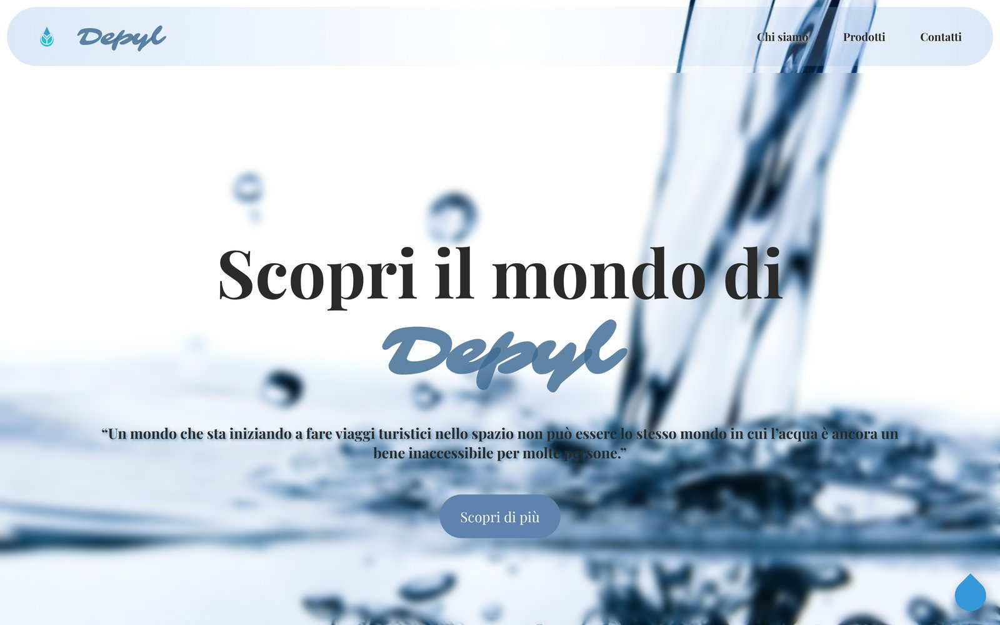
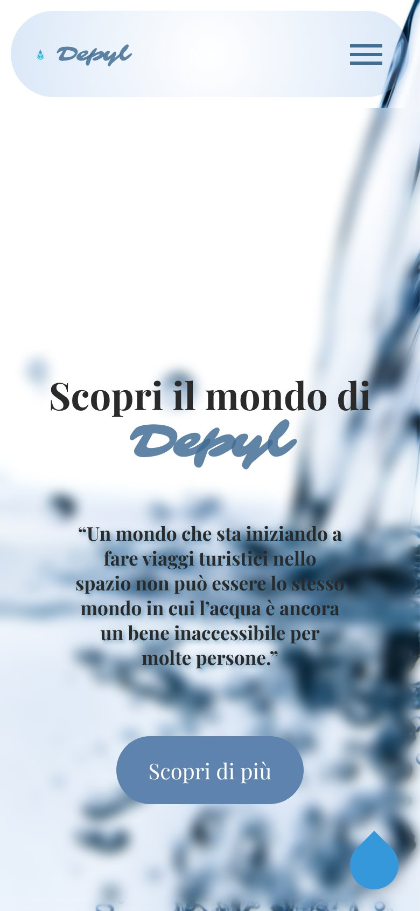
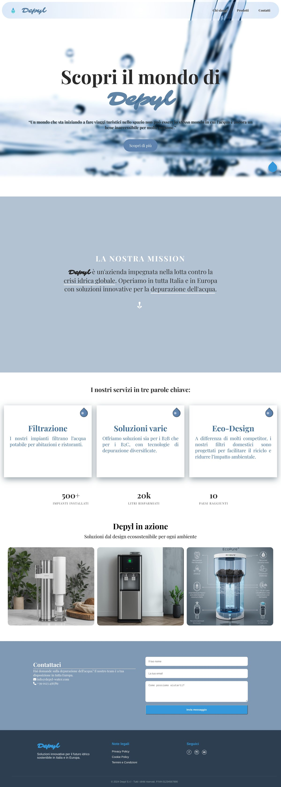

# 💧 Depyl – Soluzioni per la depurazione dell'acqua

Landing page di un'azienda che si occupa di depurazione dell'acqua, realizzata come progetto introduttivo del mio percorso da sviluppatrice web.

L'obiettivo del progetto è mettere in pratica le basi di **HTML5** e **CSS3**: struttura semantica della pagina, layout responsive, navigazione interna, animazioni e un menu mobile senza librerie esterne.

> ⚠️ Depyl è un brand inventato a scopo didattico. Contatti, partita IVA e statistiche presenti nella pagina sono dati segnaposto.

---

## 🔗 Demo







---

## 🛠️ Tecnologie utilizzate

- **HTML5** – struttura semantica (`header`, `nav`, `main`, `section`, `footer`)
- **CSS3** – layout, responsive design, transizioni e forme decorative
- **JavaScript** (vanilla) – un piccolo script per chiudere il menu mobile al clic su una voce
- **[Google Fonts](https://fonts.google.com/)** – *Playfair Display* e *Sarina*
- **[Font Awesome 6.5](https://fontawesome.com/)** – icone della sezione contatti

---

## ✨ Funzionalità e sezioni

| Sezione | Descrizione |
|---|---|
| **Header & menu** | Logo e navigazione con link alle sezioni della pagina. Su mobile il menu diventa un **hamburger realizzato solo in CSS** (tecnica della checkbox nascosta). |
| **Hero** | Titolo di benvenuto, citazione sulla crisi idrica e pulsante di invito all'azione. |
| **Chi siamo** | La mission dell'azienda, con overlay sullo sfondo, parole evidenziate e un pulsante a freccia con testo che compare all'hover. |
| **Servizi** | Tre schede (*Filtrazione*, *Soluzioni varie*, *Eco-Design*) con una forma a goccia d'acqua decorativa e riflesso, creata in CSS. |
| **Statistiche** | Barra con i numeri chiave dell'azienda. |
| **Gallery** | Griglia di immagini con overlay testuale all'hover. |
| **Contatti** | Informazioni di contatto con icone e form (nome, email, messaggio) con validazione HTML nativa (`required`). |
| **Footer** | Brand, link alle note legali e icone social. |
| **Torna su** | Pulsante a forma di goccia per tornare all'inizio della pagina. |

---

## 📁 Struttura del progetto

```
depyl/
├── index.html
└── assets/
    ├── css/
    │   └── styles.css
    ├── icon/
    │   └── favicon.ico
    └── img/
        ├── depyl-logo.png
        ├── filtro-depyl.jpg
        ├── filtro-ufficio-depyl.jpg
        ├── filtro-tecno.jpg
        ├── facebook-icon.svg
        ├── instagram-icon.svg
        └── youtube-icon.svg
```

---

## 🚀 Come visualizzarlo in locale

1. Clona il repository:
   ```bash
   git clone https://github.com/angi3xD/depyl.git
   ```
2. Apri la cartella del progetto.
3. Apri `index.html` nel browser (oppure usa un'estensione come *Live Server* di VS Code).

Non servono installazioni né dipendenze: font e icone vengono caricati da CDN.

---

## 📚 Cosa ho imparato

- Organizzare una pagina in sezioni con tag semantici
- Creare una navigazione interna con ancore (`href="#sezione"`)
- Realizzare un menu hamburger responsive usando solo HTML e CSS
- Disegnare forme decorative (la goccia d'acqua) con le proprietà CSS
- Gestire effetti hover e overlay su immagini e pulsanti
- Costruire un form di contatto con validazione nativa del browser
- Collegare font e icone esterne tramite CDN

---

## 🔮 Possibili miglioramenti futuri

- [ ] Collegare il form di contatto a un servizio di invio email (es. Formspree o Netlify Forms)
- [ ] Aggiungere `label` ai campi del form per migliorare l'accessibilità
- [ ] Animare i numeri della sezione statistiche al momento dello scroll
- [ ] Creare le pagine Privacy Policy, Cookie Policy e Termini e Condizioni
- [ ] Ottimizzare le immagini (formato WebP, `loading="lazy"`)

---

## 👩‍💻 Autrice

**Angela Giallo** – sviluppatrice web junior

- GitHub: [@angi3xD](https://github.com/angi3xD)

---

*Progetto realizzato a scopo formativo.*
*Le immagini sono state create con l'intelligenza artificiale.*